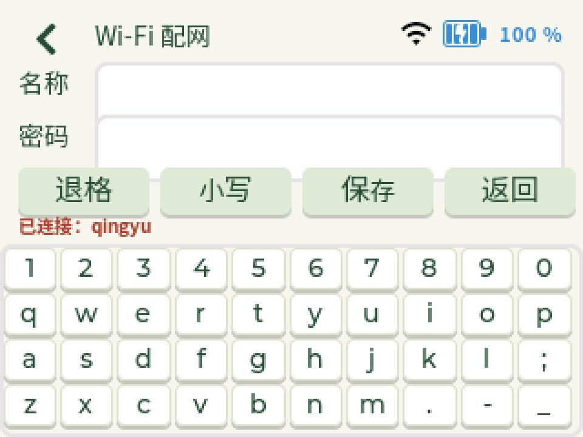
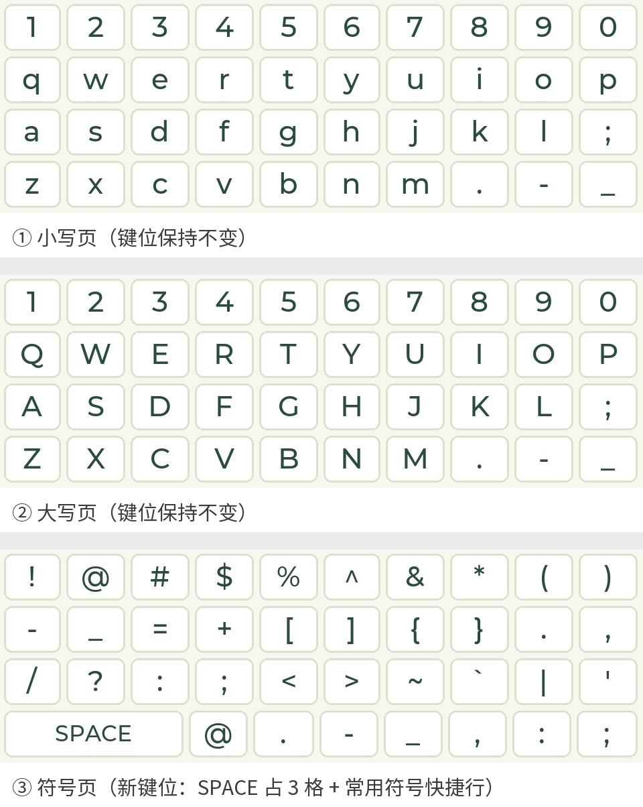
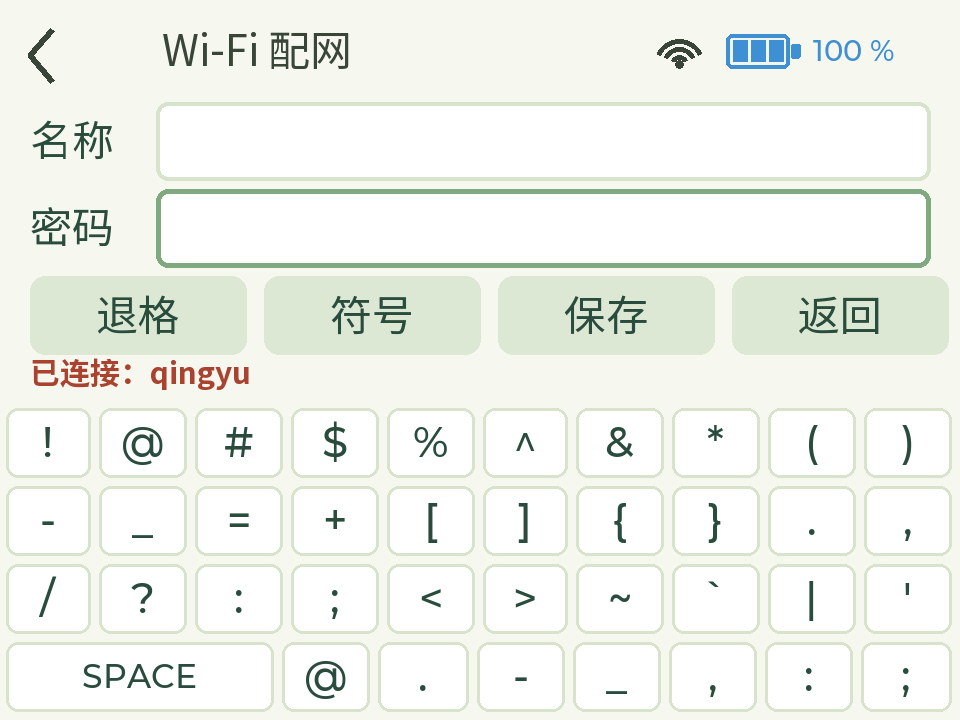
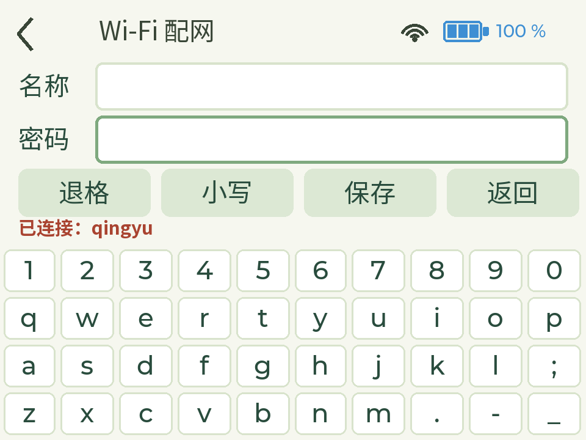
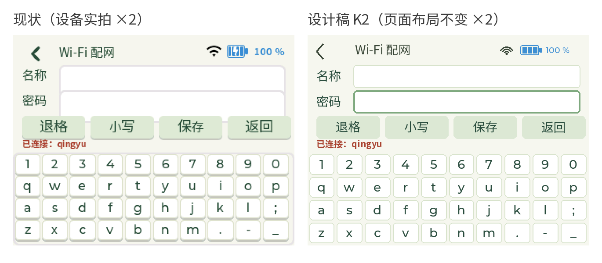
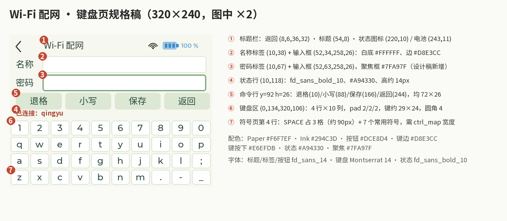

# Wi-Fi 配网页 · 键盘布局设计稿（2026-10-28）

> 目标设备：240×320 IPS 横屏（逻辑 320×240），ESP32-S3，LVGL 8.4
> 现状依据：`hardware/arduino/yiyi_desk/src/wifi_setup.cpp`（键盘/命令行/键盘区坐标与样式）+ 设备实拍 `build/review/device-allb/wifi-keyboard.png`
> 配图目录：[`design/wifi-keyboard/`](wifi-keyboard/)（生成脚本：[render_mockups.py](wifi-keyboard/render_mockups.py)）
> **本设计稿分两级**：
> - **K1 零视觉版**：键帽/排版完全不变，只修行为（抬手触发、长按退格、聚焦提示可关）。**属于布局中立**，可直接并入《优化方案 V2》Phase 2。
> - **K2 键盘内容改版（本稿主推设计稿）**：**页面外框、输入框、命令行、状态行、键盘区域坐标/尺寸全部不变**，只改符号页第 4 行键帽与空格键宽度、按键样式细节。**属视觉变化，需你确认后才实施。**

---

## 0. 一句话

现状键盘能用，但有三个真实体验问题：**符号页空格键是空白键（看不见）**、**符号页第 4 行重复符号且没有 @ . - _ 快捷位**、**退格不能长按连删**；加上审计发现的"键盘按下即输入"会让滑动误触逐键打字。K2 在**不动的 320×106 键盘区**内把这三件事修掉，页面其它像素零改动。

---

## 1. 现状（设备实拍 + 代码事实）

[](wifi-keyboard/wifi-keyboard-current-3x.png)

**页面结构（全部为现有坐标，K2 不动）**

| # | 对象 | 坐标 / 尺寸 | 样式 |
|---|---|---|---|
| ① | 标题栏 | 返回按钮 (8,6,36,32)；标题 (54,8)；WiFi 图标 (220,10)；电池 (243,11) | 标题 fd_sans_14，`#394637` |
| ② | 名称行 | 标签 (10,38,42)；输入框 (52,34,258,26) | 白底、边 `#D8E3CC`、圆角 4 |
| ③ | 密码行 | 标签 (10,67,42)；输入框 (52,63,258,26) | 白底、密码圆点 |
| ④ | 状态行 | (10,118,300) | fd_sans_bold_10，`#A94330` |
| ⑤ | 命令行 | y=92 h=26；退格(10) 小写(88) 保存(166) 返回(244)，均 72×26 | `#DCE8D4` 底、Ink 字、圆角 5 |
| ⑥ | 键盘区 | (0,134,320,106) | 4 行×10 列，pad 2/2/2，键≈29×24，白底、边 `#D8E3CC`、圆角 4、Montserrat 14、按下 `#E6EFDB` |

**键盘几何（LVGL 8.4 btnmatrix 实测公式，用于验收）**

- 内容区：`max_w = 320−2×2 = 316`，`max_h = 106−2×2 = 102`
- 行高：`no_gap_h = 102−2×3 = 96`；行 y 起点 = `134+2+24×row+2×row` → **136 / 162 / 188 / 214**，行高 **24**
- 列宽：`no_gap_w = 316−2×9 = 298`；列 x 起点 = `2+(298×i)/10+2×i` → **2, 33, 65, 97, 129, 161, 192, 224, 256, 288**，键宽 **29~30**（交替）

**现状三页键位**

| 页 | R1 | R2 | R3 | R4 |
|---|---|---|---|---|
| 小写 | `1234567890` | `qwertyuiop` | `asdfghjkl;` | `zxcvbnm.-_` |
| 大写 | `1234567890` | `QWERTYUIOP` | `ASDFGHJKL;` | `ZXCVBNM.-_` |
| 符号 | `!@#$%^&*()` | `-_=+[]{}.,` | `` /?:;<>~`|' `` | `空白键` `*+=()[]{}`（重复符号，空格键 label 是一个空格，画面上看不见） |

**现状问题（按影响排序）**

| # | 问题 | 证据 | 影响 |
|---|---|---|---|
| P1 | 符号页第 4 行第 1 键是**空白键**（label=`" "`），看起来像坏键 | `wifi_setup.cpp:51` | 用户不知道哪里输入空格；密码含空格时找不到 |
| P2 | 符号页第 4 行是重复符号 `*+=()[]{}`，**没有 @ . - _ 快捷位** | `wifi_setup.cpp:51` | 常见密码符号要翻页/换行找 |
| P3 | 键盘 `VALUE_CHANGED` 在**按下时**派发（LVGL btnmatrix 默认非 click-trig） | `lv_btnmatrix.c:432-466`，审计 P0-4 | 滑动误触时手指划过的每个键都会输入字符 |
| P4 | 退格无长按连删 | `wifi_setup.cpp:127-131`（仅 CLICKED） | 63 位密码要按几十次 |
| P5 | 模式按钮点击循环 小写→大写→符号（3 次才到符号） | `wifi_setup.cpp:118-126` | 输入符号慢 |
| P6 | 输入框聚焦无可见提示（只有光标） | `wifi_setup.cpp:313-315` | 分不清当前在改名称还是密码 |
| P7 | 按键按下反馈只有浅绿底 | `wifi_setup.cpp:336` | 小屏上反馈弱 |

---

## 2. 设计目标与硬约束

- **页面布局零变化**：标题栏、名称/密码行、命令行、状态行、键盘区坐标/尺寸/字号/颜色全部沿用现状（K2 只改键盘区内部键帽与宽度分配）。
- **不新增任何页面元素**：不加提示条、不加候选栏、不加动画、不加图标。
- **字体安全**：键盘仍用 `lv_font_montserrat_14`（ASCII）；不新增字体、不裁剪字体、不改变其它文字外观。
- **抗误触**：键帽改为**抬手触发**（`LV_BTNMATRIX_CTRL_CLICK_TRIG`），与优化方案 Phase 2 的输入层抑制配套；正常点击手感不变。
- **可回退**：所有改动集中在 `wifi_setup.cpp`（+ 可选样式），单文件回滚。

---

## 3. K2 设计稿（推荐）

### 3.1 三页键位（键盘区 4×10 不变）

[](wifi-keyboard/wifi-keyboard-pages-3x.png)

| 页 | R1 | R2 | R3 | R4 |
|---|---|---|---|---|
| ① 小写（不变） | `1234567890` | `qwertyuiop` | `asdfghjkl;` | `zxcvbnm.-_` |
| ② 大写（不变） | `1234567890` | `QWERTYUIOP` | `ASDFGHJKL;` | `ZXCVBNM.-_` |
| ③ 符号（**新**） | `!@#$%^&*()` | `-_=+[]{}.,` | `` /?:;<>~`|' `` | **`SPACE`(占 3 格，≈90px)** `@` `.` `-` `_` `,` `:` `;` |

> 说明：符号页 R1–R3 的字符集保持现状不动，避免改变常用符号位置记忆；只重排 R4 —— 空白空格变成可见的 `SPACE`，并把 Wi‑Fi 密码最常用的 `@ . - _ , : ;` 放在同一行（与 R1/R2 的重复是有意的"快捷位"）。

[](wifi-keyboard/wifi-keyboard-proposed-symbols-3x.png)

### 3.2 页面设计稿（小写页，页面布局不变）

[](wifi-keyboard/wifi-keyboard-proposed-lower-3x.png)

[](wifi-keyboard/wifi-keyboard-before-after-2x.png)

### 3.3 规格标注稿

[](wifi-keyboard/wifi-keyboard-spec-2x.png)

### 3.4 行为设计（K2 一并实施）

| 交互 | 现状 | K2 | 备注 |
|---|---|---|---|
| 单键输入 | 按下即输入 | **抬手输入**（CLICK_TRIG） | 正常点击手感不变；滑动不再逐键输入 |
| 退格 | 单次删除 | **单击删除 1 字符；长按 400 ms 后每 90 ms 连删** | 实现用 `LV_EVENT_LONG_PRESSED_REPEAT`（`lv_btnmatrix` 无长按重复，退格是独立按钮可用） |
| 模式按钮 | 单击循环 小写→大写→符号 | 单击循环；**长按直接跳符号页** | 按钮 label 随当前页显示 小写/大写/符号（现状已有） |
| 输入框焦点 | 无可见提示 | **聚焦输入框 1px `#7FA97F` 边框**（仅样式，不改尺寸） | 名称/密码切换更明确 |
| 按键feedback | 浅绿底 | 浅绿底 + 边框 `#9DBF9A`（仅样式） | 可关（K1 不做） |
| 保存/返回 | 不变 | 不变 | 保存校验/连接流程/扫描逻辑完全不动 |

> 所有行为都在 `wifi_setup.cpp` 内实现；不改 `desk.cpp` 导航、不改 `GiftUI`。

### 3.5 与抗误触/手势的关系

- 键盘键改为抬手触发后，`Touch::swiped()` guard 对键盘才有效（当前按下即触发，guard 无效——审计 P0-4）。
- 边缘手势返回仍优先于键盘输入：从键盘页左边缘右滑 → 先退出键盘（`editing→list`），不产生字符。验收见《优化方案 V2》Phase 2 的 T10/T17。

---

## 4. 精确规格（实现/验收用）

### 4.1 键盘区几何（K2 不变）

| 项 | 值 |
|---|---|
| 矩阵 rect | (0,134) 320×106 |
| pad_all / pad_row / pad_col | 2 / 2 / 2 |
| 行数 × 列数 | 4 × 10（符号页 R4 共 8 个按钮、10 个宽度单位） |
| 行 y（绝对） | 136 / 162 / 188 / 214；高 24 |
| 列 x（绝对） | 2 / 33 / 65 / 97 / 129 / 161 / 192 / 224 / 256 / 288；宽 29–30（LVGL 整除交替） |
| 键样式 | 白底、边 `#D8E3CC` 1px、圆角 4；按下底 `#E6EFDB`；字 `#294C3D`（Ui::Ink） |
| 字体 | `lv_font_montserrat_14`（键帽文字） |
| 空格键（符号页 R4） | 宽度 3 单位 ≈ **90px**（LVGL ctrl_map 宽度位；见 §5） |

### 4.2 图纸上的坐标（实现对照）

| 对象 | 坐标/尺寸 | 字号/字色 |
|---|---|---|
| 标题 | (54,8)，宽 210 | fd_sans_14 / `#394637` |
| 返回按钮 | (8,6,36,32) | 透明底，`LV_SYMBOL_LEFT`（Montserrat 20） |
| WiFi 图标 / 电池 | (220,10) / (243,11) | 资产 / BatBlue 状态色 |
| 名称标签 / 输入框 | (10,38) / (52,34,258,26) | fd_sans_14 / Ink；输入框白底 |
| 密码标签 / 输入框 | (10,67) / (52,63,258,26) | 同上；聚焦边 `#7FA97F`（K2 新增） |
| 状态行 | (10,118,300) | fd_sans_bold_10 / `#A94330` |
| 命令行 | y=92 h=26；x=10/88/166/244，w=72 | `#DCE8D4`、圆角 5、fd_sans_14 |
| 键盘区 | (0,134,320,106) | 见 §4.1 |

### 4.3 键帽表（实现直接照抄）

```c
// 小写 / 大写：与现固件完全一致（不改）
// 符号页 K2（替换 wifi_setup.cpp:47-51 的 kbMapSymbols）：
static const char *const kbMapSymbols[] = {
    "!", "@", "#", "$", "%", "^", "&", "*", "(", ")", "\n",
    "-", "_", "=", "+", "[", "]", "{", "}", ",", ".", "\n",
    "/", "?", ":", ";", "<", ">", "~", "`", "|", "'", "\n",
    "SPACE", "@", ".", "-", "_", ",", ":", ";", ""};
// R4 宽度由 ctrl_map 指定：SPACE=3 单位、其余 7 个=1 单位
```

> ⚠️ `SPACE` 用 ASCII 是因为 btnmatrix 全矩阵只有一个文字字体（Montserrat 14，无 CJK）；写成"空格"会掉字。若必须中文，需改成独立按钮+自定义布局（会动结构，不推荐）。

---

## 5. 实现落点（全部在 `hardware/arduino/yiyi_desk/src/wifi_setup.cpp`）

| 改动 | 位置 | 说明 |
|---|---|---|
| 符号页键帽 | `kbMapSymbols`（现 :47-51） | 换成 §4.3 表；R4 用 `"SPACE"` |
| R4 宽度 + 抬手触发 | `render()` 键盘创建处（现 :322-337） | `lv_btnmatrix_set_ctrl_map(keyMatrix, ctrl)`；每键 `LV_BTNMATRIX_CTRL_CLICK_TRIG`，R4 第 1 键 `| 3`（宽度位 3） |
| 退格长按连删 | 命令行 `editButton("退格",10,92,...)`（现 :317） | 追加 `LV_EVENT_LONG_PRESSED_REPEAT`；`backspaceEvent` 已按字符删除，重复事件直接复用 |
| 模式按钮长按跳符号 | `modeButton`（现 :318） | 追加 `LV_EVENT_LONG_PRESSED`，`keyMode=2` 后刷新 map/label |
| 聚焦框 | textarea 样式（现 :313-315） | 事件里设/清 `border_color #7FA97F`（1px，不改尺寸/坐标） |
| 按键按下边色 | 键盘样式（现 :329-336） | `LV_PART_ITEMS|LV_STATE_PRESSED` 加 `border_color #9DBF9A`（仅样式） |
| 不改 | 列表页、扫描、连接、保存、错误提示、坐标 | 全部保持 |

---

## 6. 验收（设备实拍对照）

1. **像素验收（三页）**：`page 6 → tap Settings → tap WiFi 行 → tap 手动输入`，分别切三页截图，与 `design/wifi-keyboard/wifi-keyboard-pages-3x.png` 对照：键位置/文字/空格宽度一致（±1px）。
2. **K1/K2 行为验收**：
   - 正常点击 `1` → 密码框出现 1 个圆点（正向对照）；
   - 键盘上起点滑动 → **不输入任何字符**（修复前逐键输入，T10）；
   - 长按退格 1s → 连续删多个字符；
   - 点击模式按钮 1 次 → 大写页；长按模式按钮 → 符号页；
   - 聚焦切换名称/密码 → 边框高亮切换。
3. **非键盘区域像素 0 变化**：设备 golden 对照（同一时间/网络/电池状态）键盘区以外 0 差异。
4. 页面尺寸/坐标回归：键盘区仍 (0,134,320,106)，命令行/输入框坐标不变（对照本稿 §4.1/§4.2）。

---

## 7. 备选方案（未采用，供决策）

| 方案 | 内容 | 优点 | 不采用原因 |
|---|---|---|---|
| **K1 零视觉** | 键帽全不变；只做 CLICK_TRIG + 长按退格（+可选聚焦提示） | 完全布局中立、可直接并入 V2 | 空白空格键/重复符号问题仍在 |
| **K3 大键 3×10** | 键盘改 3 行×10（键 30×31） | 触摸目标更大 | 每页只能放 30 键，需多加一页/更多模式切换，视觉改动大，违背"不改布局" |
| **K4 系统 lv_keyboard** | 用 LVGL 自带键盘 | 省代码 | 字体缺 `LV_SYMBOL_*`、4 行放不进 320×240（代码注释已写明，不可行） |

---

## 8. 需要你确认（K2 才需要）

1. **采用哪版**：K2 键盘内容改版（推荐设计稿）/ K1 零视觉（只修行为）/ 暂不改键盘。
2. **K2 属于视觉变化**（键帽/空格宽度/按键样式），页面布局不变；确认后追加到《优化方案 V2》Phase 2，预计 **+1–1.5h**（键位/ctrl_map/长按/样式 + 三页截图验收）。
3. 空格键标签用 **`SPACE`** 是否接受（中文"空格"需要改结构才能显示）。
4. 长按参数：退格 400ms 后 90ms/字符；模式长按直接跳符号页——是否按此默认。

> 若只想"不改任何视觉"，选 K1：本设计稿的图纸仅作参考，实施只做行为三件事（CLICK_TRIG、长按退格、可选聚焦提示可先不做）。

---

## 9. 实板实施结果（2026-10-28，K2 已落地）

K2 已按本稿 §4/§5 实施并烧录验证（固件 `5,787,104 B / 58.09%`；设备 `status.sketchMd5=b2b4944e…`，对应 bin SHA-256 `B2599156758E…`）。实板截图（320×240，设备 golden 帧）：

| 页 | 实板截图 |
|---|---|
| 小写 | [device-k2-lower-320x240.png](wifi-keyboard/device-k2-lower-320x240.png) |
| 大写 | [device-k2-upper-320x240.png](wifi-keyboard/device-k2-upper-320x240.png) |
| 符号（新键位） | [device-k2-symbols-320x240.png](wifi-keyboard/device-k2-symbols-320x240.png) |

前后 diff 证据（设备 golden，旧基线→K2）：[符号页 diff](wifi-keyboard/device-k2-symbols-before-after-diff.png)；数值记录 `build/device-golden/last/update-report.json`（lower 36px、upper 222px、symbols 2152px，均在键盘/命令行区域）。

**与设计稿的差异**：聚焦边框只画**上/左/右**三边（不是四边）。原因：输入框实际底边落在命令行 y=92 后面（既有布局重叠），四边着色会在按钮间隙露出 1px 绿色短线（设备 golden 差 18px）；三边方案消除了该现象。小写/大写页聚焦时底边在 3 个按钮间隙处少 1px 主题边框（不可见级别）。其余键位、SPACE 宽度、长按行为、按下态、聚焦高亮与设计稿一致。

**验收**：设备 golden 中 28 个非键盘视图逐字节 0 差异（布局未变）；键盘三视图已用 `--update-only` 更新为新的 no-change 门禁；`check_mistouch_device.py`（T0–T17）与 `check_gestures_device.py`（D1–D22）均 PASS，详见 `代码审查/V2实施执行记录-20261028.md`。
