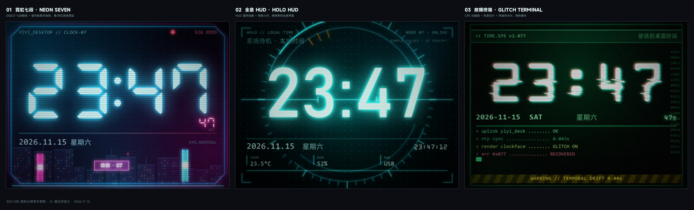
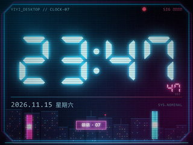
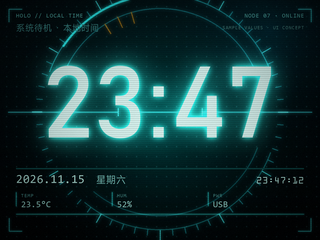
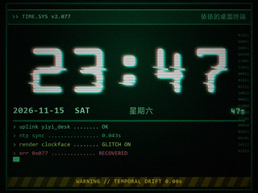

# 赛博朋克时钟样式调研 · 2026-11-15

本轮只做**样式搜索 + 桌面调研 + 320×240 示意稿**：不改固件、不刷设备、不引入第三方代码。目标设备不变：ESP32-S3 N16R8、2.8 寸 IPS 横屏 **320×240**、LVGL 8.4；已有「时光动画（GIF）/ Pixel Clock / 白色翻页」三种钟面。

> **Flash 口径更正**：本任务描述里的 "app0 余约 2.0 MiB" 是 2026-11-13 的旧口径。仓库最新记录（`0.19.5-games-entry`，2026-11-15）为镜像 **8,015,760 B**、8.5 MiB 分区**余 897,136 B ≈ 0.86 MiB**。下面所有体积估算按 **0.86 MiB** 口径核对，特此说明。

- **视觉调研底稿**：本目录 `research-visual-notes.md`（18 条视觉参考，全部附 URL 与核验状态；原始底稿同时在 `build/research/cyberpunk-20261115/visual/notes.md`）
- **代码/落地调研底稿**：本目录 `research-code-notes.md`（8 个项目 + LVGL 8.4 API 逐条核验；原始底稿同时在 `build/research/cyberpunk-20261115/code/notes.md`）
- **示意稿**：本目录 `mockups/`，三张 320×240 真机分辨率稿 + 2× 对照图 + 配色卡
- **复现脚本**：本目录 `render_mockups.py`（纯本地 Pillow 绘制，不依赖网络）

---

## 一、先看结论

### 1. 赛博朋克钟面不是一个样式，而是一组可切换的「主题」

目前市面上做得最完整的一份参考，是 BOOTH 上的 [Crafloq 赛博朋克时钟主题包](https://booth.pm/en/items/8994249)（200 日元，10 套额外主题，支持时钟/倒计时/正计时三模式）。它把"赛博朋克"拆成 10 个命名主题：

`Neon Alley`（青+洋红霓虹）、`Hacker Terminal`（绿色终端）、`Chrome Edge`（冷铬）、`Night Tokyo`（粉色夜景）、`Combat HUD`（琥珀仪表）、`Hologram`（全息）、`Glitch Signal`（故障信号）、`Synthwave`（合成波）、`Black Ice`（克制冰蓝）、`Cyber Cat`（猫轮廓赛博显示）。

这正好对应我们设备的「钟面」粒度：**不做一整套赛博皮肤，而是新增 1–2 个可切换钟面**。其中 `Cyber Cat` 说明「猫 + 赛博」是成立的组合，可以自然接上项目的黑猫 IP。

### 2. 320×240 上真正值得做的三条主线

| 方向 | 为什么 | 成本 | 代价 |
|---|---|---|---|
| **A 霓虹七段 + 城市剪影** | 七段字形可用代码/开源字库画，深底高对比，最容易"出片" | 背景 77–150 KB + 代码 30–60 KB | 辉光过度会糊；洋红面积必须 ≤5% |
| **B 全息 HUD 圆环 + 大号时间** | 细线 + 刻度信息密度低，长期看最不累，和现有森林礼物气质冲突最小 | 代码 20–40 KB，几乎不用图 | 1px 线在 2.8" 上可能发虚，需整数坐标或 2px 线 |
| **C 故障终端（绿 CRT）** | 等宽字 + 扫描线 + 警告条，几乎纯代码，最便宜 | 代码 15–30 KB | "礼物感"偏冷，只适合彩蛋或夜间 |

**建议**：先做 **A** 作为"生日/拍照彩蛋"，**B** 作为第二个日常钟面（夜间/低刺激），**C** 不做或只做彩蛋。赛博朋克不要动默认森林主页（见第八节）。

按最新余量 **0.86 MiB** 核对：三款全做约 250–490 KiB（含预览图），仍放得下但只剩 400–650 KiB 机动；**建议先做 1 款（约 80–170 KiB），确认效果后再决定第二款**。

### 3. 已按真机分辨率画出三张示意稿

从 18 条参考里提炼出的共同结论：**赛博朋克的辨识度靠"深底 + 少量霓虹 + 硬边信息框 + 一等宽字体"，不靠满屏特效**。三张稿分别对应上面的 A / B / C。

---

## 二、10 种赛博朋克时钟样式清单

> 命名参考 BOOTH 主题包；每类给出「视觉记忆点 → 320×240 适配 → 实现成本」。这是本轮"搜索到"的样式全集，后续选型从这里挑。

| # | 样式 | 视觉记忆点 | 320×240 适配 | 成本 |
|---|---|---|---|---|
| 1 | **Neon Alley** 青洋红霓虹 | 深底 + 青/洋红霓虹管数字、雨夜反光 | 高；七段数字 + 底部 44px 剪影即可 | 中，背景 77–150 KB |
| 2 | **Hacker Terminal** 绿色终端 | 等宽字、扫描线、`>` 提示符、错误信息 | 高；几乎纯文字和 1px 线 | 低，15–30 KB |
| 3 | **Chrome Edge** 冷铬金属 | 银蓝渐变、硬边高光、拉丝金属 | 中；渐变与高光要预烘焙成图 | 中，需 1–2 张材质图 |
| 4 | **Night Tokyo** 粉色夜景 | 城市剪影 + 霓虹招牌 + 车辆光流 | 高；静态剪影底图 + 数字 | 中，背景 77–150 KB |
| 5 | **Combat HUD** 琥珀仪表 | 圆环、刻度、准星、四角括号 | 高；LVGL `arc/line` 直接画 | 低–中，20–40 KB |
| 6 | **Hologram** 全息 | 半透明面板、网格、微光扫描 | 中；透明叠层 + 低对比文字，可读性最差 | 中 |
| 7 | **Glitch Signal** 故障信号 | RGB 色差、切片错位、信号噪声 | 中；**只能瞬时**，常驻会糊且开销 ×3 | 低，但必须限时 |
| 8 | **Synthwave** 合成波 | 紫粉渐变、透视网格地面、落日 | 中；渐变得预烘焙并注意 RGB565 断带 | 中 |
| 9 | **Black Ice** 克制冰蓝 | 细线、低饱和、留白、冷光 | 高；最耐看，最适合夜间常亮 | 低 |
| 10 | **Cyber Cat** 猫轮廓 | 用猫/猫耳的轮廓参与数字或装饰 | 高；与项目黑猫 IP 天然契合 | 低–中，可复用现有猫素材 |

---

## 三、参考来源（按用途分类）

> 可信度：**核验** = 本次 `web_fetch` 实际打开并读到正文/规格；**仅标题** = 只拿到搜索标题与 URL，未取得正文。完整 18 条（含每条详细看点）见本目录 `research-visual-notes.md`。

### A. 成品与主题（最有"可买/可抄"价值）

| # | 名称 | 链接 | 看点 | 可信度 |
|---|---|---|---|---|
| A1 | Crafloq 赛博时钟主题包（10 套） | [booth.pm/en/items/8994249](https://booth.pm/en/items/8994249) | 把赛博拆成 10 个可切换主题；含 `Cyber Cat` 猫形显示 | 核验 |
| A2 | THANKO「Cyber punClock ghost」 | [thanko.jp](https://www.thanko.jp/view/item/000000004074) | 6 支玻璃罩 LCD + RGB 背光，27 种数字样式；"辉光管"拆成外框/屏内容/氛围光三层 | 核验 |
| A3 | Amazfit GTS「Cyberpunk 2077」表盘 | [amazfitwatchfaces.com/gts/view/1365](https://amazfitwatchfaces.com/gts/view/1365) | 粉丝向表盘：数字 + 霓虹 + 作品符号三件套即成立 | 核验 |
| A4 | Amazfit GTR 3「MK CyberPunk 2077」 | [amazfitwatchfaces.com/gtr/view/28740](https://amazfitwatchfaces.com/gtr/view/28740) | 同类成品表盘的排版密度参考 | 核验 |
| A5 | 小米手环「赛博朋克丽贝卡」动态表盘 | [bandbbs.cn/resources/6633](https://www.bandbbs.cn/resources/6633/) | 动态表盘 + 独立 AOD 图；点击热区做彩蛋 | 核验 |
| A6 | Garmin「Cyberpunk RAD Watch Face」 | [apps.garmin.com](https://apps.garmin.com/en-US/apps/80a1252b-5dd5-4686-be3a-58e80a005573) | 低分辨率、强日照、常亮场景的赛博表盘在售 | 核验（仅规格） |

### B. 前端演示与组件（效果怎么实现）

| # | 名称 | 链接 | 看点 | 可信度 |
|---|---|---|---|---|
| B1 | Futuristic Neon Digital Clock（CodePen） | [codepen.io/Uly-Wae/pen/OPLqemp](https://codepen.io/Uly-Wae/pen/OPLqemp) | 时/分/秒三块卡片 + 极小标签 + Orbitron + `#00FF9F`；信息分层几乎就是 320×240 最优解 | 核验 |
| B2 | Cyberpunk Glitch Walkthrough（CodePen） | [codepen.io/doomsdayproductions/pen/yLRGqbK](https://codepen.io/doomsdayproductions/pen/yLRGqbK) | 两层文字副本 + 洋红/青色偏 + 硬切关键帧；可整段翻译成 150–300ms 瞬时闪 | 核验 |
| B3 | 赛博朋克 UI 组件库（43 组件） | [enotsixlm.github.io](https://enotsixlm.github.io/game-ui-kits/cyberpunk-ui-kit.html) | 切角面板、四角括号、环形计量表、`ID://0xF3A9` 副标——HUD 标准件清单 | 核验 |
| B4 | NeonClock（Framer 组件） | [framer.com](https://www.framer.com/community/marketplace/components/neonclock/) | 复古霓虹数字钟组件，适合做视觉对照 | 仅标题 |
| B5 | Neon 3D Seven-Segment Clock（FreeFrontend） | [freefrontend.com](https://freefrontend.com/code/neon-3d-seven-segment-digital-clock-2026-03-02/) | 立体七段 + 霓虹，纯 CSS 实现思路 | 仅标题（页面重定向循环） |

### C. 方法论与配色（避免"廉价霓虹"）

| # | 名称 | 链接 | 看点 | 可信度 |
|---|---|---|---|---|
| C1 | 《赛博朋克 2077》UI 拆解（GameRes） | [gameres.com/893578.html](https://www.gameres.com/893578.html) | 互补霓虹并置会产生"色彩颤动"；给文字加荧光反而更难读——小屏要反着做 | 核验 |
| C2 | 10 Neon & Cyberpunk Color Palettes（Pikka） | [pikka.app](https://pikka.app/blog/10-neon-cyberpunk-color-palette-ideas-glowing-hex-codes) | 可直接抄的 10 组 hex；4 条工程规矩：多层辉光、别用纯黑、90/10 用色、移动端慎用重辉光 | 核验 |
| C3 | 赛博朋克风格谱（StyleAtlas） | [styleatlas.art/styles/cyberpunk](https://styleatlas.art/styles/cyberpunk/) | 55/30/15 面积比；青洋红不是必须；反对"随机亚洲文字制造未来感" | 核验 |
| C4 | 赛博朋克设计提示词（UI Prompts） | [luckymaomi.github.io](https://luckymaomi.github.io/ui/ui-prompts/cyberpunk/) | 完整的赛博 UI 配方：暗底霓虹、切角、扫描线、glitch、等宽字、发光 CSS | 核验 |
| C5 | Cyberpunk 2077 HUD Painter Resource | [wiki.redmodding.org](https://wiki.redmodding.org/cyberpunk-2077-modding/~/revisions/i2tESnfvLSkCQYz2sa6F/modding-guides/hud-painter-resource) | 2077 HUD 的构成（颜色/警告条/字体）参考 | 仅标题 |

### D. 实物与艺术装置（氛围与分层参考）

| # | 名称 | 链接 | 看点 | 可信度 |
|---|---|---|---|---|
| D1 | Tokyoflash「Sliced」LED 表 | [blog.tokyoflash.com](https://blog.tokyoflash.com/2013/01/16/sliced-led-watch-slashes-its-way-though-time/) | 只给七段加"斜切刀口"就够赛博，不牺牲识读 | 核验 |
| D2 | Elecrow 复古未来混合钟 | [elecrow.com](https://www.elecrow.com/sharepj/retro-futuristic-hybrid-clock-1226.html) | "秒"交给灯效表演，LCD 只负责安静时分——动效分配思路 | 核验 |
| D3 | A.S.M. Kobayashi《Electric Neon Clock》 | [artgalleryofmississauga.com](https://www.artgalleryofmississauga.com/events/a-s-m-kobayashi-electric-neon-clock/) | 把霓虹钟当叙事装置；对"礼物"属性有启发 | 核验（正文截断） |
| D4 | 小红书「赛博朋克时钟」桌面摆件 | [xiaohongshu.com](https://www.xiaohongshu.com/discovery/item/6928590b000000001e022be8) | 消费级桌面赛博钟的真实观感（用户实拍） | 仅标题 |

### E. 工程实现（GitHub / ESP32 / LVGL / 字体）

> 星数、许可证与 API 结论来自本目录 `research-code-notes.md`：星数为 2026-11-15 通过 shields.io 观察值；LVGL 结论以本地实际使用的 **8.4.0 源码**为准，不是网页文档。

| # | 名称 | 链接 | 星 / 许可 | 能借鉴什么 | 难度 |
|---|---|---|---|---|---|
| E1 | **fbiego/esp32-c3-mini** | [github.com/fbiego/esp32-c3-mini](https://github.com/fbiego/esp32-c3-mini) | 551★ / MIT | 最成熟的 LVGL 表盘工程结构：整屏背景 + 少量动态层；42 款表盘含 neon / glow / terminal / radar | A（结构）/ B（代码） |
| E2 | **JnCrMx/cyberwatch** | [github.com/JnCrMx/cyberwatch](https://github.com/JnCrMx/cyberwatch) | 3★ / **无 LICENSE** | 唯一真正的 Cyberpunk 2077 风格 ESP32 手表固件（ESP32-S3 + LVGL 9.2.2 + SDL 模拟器）；**代码不能抄**，只借配色/布局/工作流 | C |
| E3 | **andjiang0083/cyber-clock** | [github.com/andjiang0083/cyber-clock](https://github.com/andjiang0083/cyber-clock) | 0★ / MIT | ESP32-S3 真机跑过的赛博桌面钟：数字雨、6 套霓虹配色、33 fps、Flash 1.18 MB；算法可迁移 | B |
| E4 | sebyx07/cybercore-css | [github.com/sebyx07/cybercore-css](https://github.com/sebyx07/cybercore-css) | 82★ / MIT | glitch / scanline / neon border / datastream 的 CSS 配方库；配色 token：`#00f0ff` `#ff2a6d` `#fcee0a` `#05ffa1` `#0a0a0f` | C→B（翻译成 LVGL 分层） |
| E5 | keshikan/DSEG | [github.com/keshikan/DSEG](https://github.com/keshikan/DSEG) | ≈1.2k★ / **SIL OFL 1.1** | 唯一可安全嵌入固件的七段字体（DSEG7/14）；冒号与空格等宽、句点零宽 | A（转 LVGL 字体） |
| E6 | xxjun9527/jarvis-holographic | [github.com/xxjun9527/jarvis-holographic](https://github.com/xxjun9527/jarvis-holographic) | 45★ / MIT | 钢铁侠 HUD 的构图语言：外环刻度 + 中环数据 + 中心主数字 | C |
| E7 | fbiego/esp32-lvgl-watchface | [github.com/fbiego/esp32-lvgl-watchface](https://github.com/fbiego/esp32-lvgl-watchface) | 75★ / MIT | `bin2lvgl` 工具链思路：把设计稿整屏图转成 LVGL 资源 | B |
| E8 | nickluong-dev/Cyber-Clock | [github.com/nickluong-dev/Cyber-Clock](https://github.com/nickluong-dev/Cyber-Clock) | 0★ / 无许可 | 2020 年网页作品，无维护，参考价值低 | C（可跳过） |

> 另：`gadgeski/Vetro`（赛博朋克翻盖手机桌面摆件）只出现在搜索结果标题里，本次未核验到正文，未列入上表；Dribbble/Behance 等视觉平台同样受限（见第十节）。

> 说明：Dribbble（HTTP 202 空响应）、Behance（DNS 被拦）、Pinterest、UI 中国（403）、Awwwards（纯 JS）、StockCake（Cloudflare 403）本次均无法取得正文，因此没有 Dribbble/Pinterest 的"核验"级条目；替代覆盖见 A、B、C 组。清单未凭记忆编造 URL。

---

## 四、8 个视觉母题（附 320×240 可行性）

| # | 母题 | 为什么像赛博朋克 | 320×240 做法 | 可行性 |
|---|---|---|---|---|
| 1 | **霓虹七段 + 多层辉光** | 电子表血统 + 城市霓虹光源 | 4 位数字每位约 56×80；辉光用 2–3 层同色描边/预渲染光晕，不做实时模糊 | 高 |
| 2 | **扫描线 / CRT 荫罩** | "高科技、低生活"的旧设备物证 | 3–4px 节距、透明度 8–12%、**只盖背景不盖数字**；烘焙进底图最省 | 中 |
| 3 | **RGB 色差 / 切片错位** | 信号故障 = 系统不可信 | 只做 150–300ms 瞬时闪（秒跳/切钟面时），不要常驻 | 低（限时做） |
| 4 | **HUD 圆环 + 刻度 + 四角括号 + 切角面板** | 军事/仪表 HUD 的压迫感 | `lv_arc` 秒弧 + `lv_line` 刻度；四角括号每角 12×12；切角用 3 段直线 | 高 |
| 5 | **赛博城市天际线剪影** | 最省像素的世界观暗示 | 底部 44–56px 两层剪影 + 1px 亮窗；纯静态，只占底部一条 | 高 |
| 6 | **警告条 / 伪造系统文案** | 工业安全色 + "要出事"的压迫 | 14–18px 黄黑斜纹条（平铺小图约 2KB）+ 8px 等宽字 | 高 |
| 7 | **青/洋红双色霓虹（90/10 纪律）** | 互补色并置产生色彩颤动 | 主光只占约 10% 面积，其余 `#05060A` 深底；第二色只做 1–2 个 4px 强调点 | 高（需克制） |
| 8 | **等宽 / 科技几何字体 + 小号编码文案** | 终端与代码、航天仪表 | 大数字用七段/DSEG7，辅助信息 8px 等宽；中文 ≥12px，沿用现有字库 | 高 |

---

## 五、配色与字体

### 1. 可直接用的色板

| 角色 | Hex | 用途 |
|---|---|---|
| 画布（void） | `#05060A` | 整屏底，**不用纯黑**（纯黑无法分层） |
| 面板 | `#0D0E15` / `#13141F` | 状态条、信息格 |
| 主光·青 | `#00F0FF` | 七段数字 / 秒弧主色 |
| 次青 | `#4EB8DD` | 小标签、单位 |
| 主光·洋红 | `#FF003C` | 冒号、秒点、状态灯（≤5% 面积） |
| glitch 洋红 | `#E0287D` | 色差闪偏移层 |
| glitch 青 | `#1BC7FB` | 色差闪另一层 |
| 琥珀 | `#FFB703` | 夜间模式主色 / 温度 |
| 荧光绿 | `#00FF66` | 终端彩蛋模式 |
| 警告黄 | `#FFE600` | 底部警告条斜纹 |

**面积纪律**：底/次色/强调 ≈ 55/30/15（StyleAtlas）；霓虹只占约 10% 面积（Pikka 90/10 规则）。同一钟面只用 **1 个主光色 + 1 个强调色**。

### 2. 字体

| 用途 | 候选 | 授权备注 |
|---|---|---|
| 七段数字 | DSEG7 Classic Mini Bold | SIL OFL，可子集化；本仓库已有该字体文件（`build/research/.../3dClock-main/DSEG7ClassicMini-Bold.ttf`） |
| 科技展示字体 | Orbitron / Chakra Petch / Rajdhani / Michroma | 均为 OFL（SIL Open Font License），可子集化 |
| 等宽小字 | JetBrains Mono / IBM Plex Mono / Share Tech Mono | OFL，可子集化 |
| 中文 | 现有 Noto Sans SC 12/16px 字库 | 不新增全量 CJK；正文 ≥12px |
| 示意稿里用的 | Bahnschrift / OCR A Extended / Consolas | **仅桌面端渲染示意，不进固件**（系统字体不可再分发） |

字距：结构性英文标签全大写、`letter-spacing ≈ 0.15–0.25em`；中英混排行高 ≥1.3 倍。**不要用随机日文/伪亚洲文字制造"未来感"**（StyleAtlas 明确反对；要么写对，要么标明虚构代号）。

---

## 六、三张 320×240 示意稿

> 均为**真机分辨率 320×240**，`mockups/` 内附 3× 最近邻放大图便于看像素；作图方式是本地 Pillow 绘制（`render_mockups.py`），不是网页截图，也不代表最终美术。示例时间/日期/数值都是排版示意。稿中字体（Bahnschrift / OCR A / DSEG7 / 微软雅黑）只用于桌面渲染，固件必须换成 OFL 字体或自绘七段。

### 稿 01 · 霓虹七段 NEON SEVEN

- **版面**：顶部 16px 状态条（`YIYI_DESKTOP // CLOCK-07` + 信号灯）→ 78px DSEG7 大时间（`#39E8FF` 青，洋红秒数）→ 青→洋红细分割线 → 日期行（`2026.11.15` + 星期六 + `SYS.NOMINAL`）→ 底部 44px 城市剪影（暖窗、霓虹招牌、`依依 · 07` 小广告牌）。
- **气质**：暖机箱里的一小块"夜之城"，最出片；广告牌和 `YIYI_DESKTOP` 作为礼物彩蛋。
- **动效**：冒号 1Hz 闪烁；秒数换位每 10s 一次 120ms 的 1px 色差闪；剪影每 30s 平移 2px。总重绘面积 <20%/秒。
- **成本估算**：静态底图（含剪影/扫描线）77.8 KB（8-bit 索引）或 150 KB（RGB565）；DSEG7 子集 4–10 KB 或自绘七段 0 KB；代码 30–60 KB；钟面预览图 30–43 KB（现有机制）。合计约 **110–180 KiB**。

### 稿 02 · 全息 HUD HOLO HUD

- **版面**：顶部双标签（`HOLO // LOCAL TIME` / `NODE 07 · ONLINE`）→ 半径 118px 的 HUD 圆环（60 条刻度 + 亮弧）→ 100px Bahnschrift 大时间（青白核心 + 青绿辉光）→ 日期行与秒读数 → 三格遥测（TEMP/HUM/PWR，仅示意）→ 四角括号 + 点阵底纹。
- **气质**：最"耐看"、最安静的赛博，细线不抢眼，最适合作为长期钟面或夜间模式。
- **动效**：秒用弧长表达（每分钟一圈，每秒重绘约 6°）；切钟面时环扫描一圈 600ms；刻度不动。
- **成本估算**：代码 20–40 KB；不需要大背景图（点阵/圆环/细线用绘制事件）；可选 HUD 底纹 10–20 KB；预览图 30–43 KB。合计约 **60–100 KiB**。
- **风险**：1px 线在 2.8" IPS 上可能发虚——用整数坐标、必要时 2px 线；中文小字 ≥12px。

### 稿 03 · 故障终端 GLITCH TERMINAL

- **版面**：反色标题栏（`>> TIME.SYS v2.077` / `依依的桌面终端`）→ 84px OCR 字形的绿白时间（洋红/青 RGB 色差 + 横向切片）→ 日期行 + 秒读数 → `>` 终端命令行（uplink/ntp/render，含一条洋红 `err 0x077 RECOVERED`）→ 右缘二进制列 → 底部黄黑警告条 `WARNING // TEMPORAL DRIFT 0.00s`。
- **气质**：最"冷"、最便宜；建议只做彩蛋（比如整点/生日当天出现），不做日常默认钟面。
- **动效**：平时静态；每 10–20 秒一次 200ms 的 glitch；整点或切换时来一次强的。
- **成本估算**：代码 15–30 KB + 静态底纹/警告条 ≤5 KB + 预览图 30–43 KB。合计约 **50–80 KiB**。

---

## 七、LVGL 8.4 落地要点

> 依据：`research-code-notes.md` 对**本地实际使用的 LVGL 8.4.0 源码**（`C:\Users\Tian\Documents\Arduino\libraries\lvgl`，version 8.4.0）逐条核验，另参考本项目现有钟面实现（`dashboard_clock_page.cpp` 等）。具体帧率以实板为准。

### 1. 能力边界（已核验，别再按网页示例假设）

| 问题 | 8.4.0 的实际情况 |
|---|---|
| 模糊 / 发光滤镜 | **没有对象级/样式级模糊与发光**。全库只有 `lv_canvas_blur_hor/ver()` 两个**软件模糊函数**（作用于 canvas 像素缓冲，一次性） |
| 文字 shadow | **没有**。`lv_draw_label_dsc_t` 只有 `opa`；官方 workaround 是两层 label 叠加 |
| `shadow_*` 样式 | 只对**圆角矩形区域**生效，挖空本体；与字形/图片 alpha 无关，不能当文字发光 |
| 渐变 | 只有 `LV_GRAD_DIR_HOR / VER`，**没有径向/锥形渐变** |
| 图片平铺 | **没有** tile API → 扫描线/网格必须烘进背景图 |
| 混合模式 | `NORMAL / ADDITIVE / SUBTRACTIVE / MULTIPLY`（无 DIFFERENCE）；文字/弧/线/矩形/图片都支持 → **发光主力** |
| 图片染色 | `ALPHA_8BIT` + `img_recolor` 有快速路径（1 B/px）；`ALPHA_4BIT` 反而没有 |
| 缩放/旋转图片 | 本项目 `LV_IMG_CACHE_DEF_SIZE=0`，每帧重新采样 → **glitch 只做位移，不做 zoom** |
| 阴影缓存 | `LV_SHADOW_CACHE_SIZE=0`（本项目未改）→ 每帧重算角块，大 shadow_width 很贵 |
| `lv_meter` | 可用：刻度环 + 主刻度 + 弧指示器，天然适合 HUD |
| 整帧传输上限 | SPI 40 MHz，整帧 153,600 B ≈ **31–40 ms**（含命令开销）→ 全屏动画实际约 **15–20 fps**；`LV_DISP_DEF_REFR_PERIOD` 默认 30 ms |

> 网上大量"赛博朋克 LVGL 示例"是 LVGL 9.x（`lv_scale`、drop shadow 等），**8.4 没有这些 API**；`lv_meter` 在 9.x 已被 `lv_scale` 取代。

### 2. 三款稿对应的落地做法

1. **资源分层**：静态底图（背景 + 剪影 + 扫描线/网格）→ 时间层（每分钟变）→ 秒层（每秒变）→ 一次性特效层。底图只解码/加载一次，绝不每帧重绘全屏渐变。
2. **辉光（不实时模糊）**，任选：
   - 离线把光晕烘进 `ALPHA_8BIT` 蒙版，运行时 `img_recolor` 染色（1 B/px，最快）；
   - 同文本/图形画 2–3 份副本，外扩 1–2px、`text_opa` 30–60、`blend_mode=ADDITIVE`，再叠清晰实色层；
   - 最省：只做 1–2px 同色描边 + 亮色实心，放弃大范围辉光。
3. **七段数字**：**自绘 7 个圆角矩形 = 0 字体 Flash**，还能任意加外围光晕；若要用字体，DSEG7（OFL 1.1）转 LVGL 字体约 6–12 KB。**不要嵌入 Digital-7**（Style-7 授权不明确，非 OFL）。
4. **扫描线/点阵/网格/天际线**：全部烘进 `INDEXED_8BIT` 背景图（320×240 = 76,800 B + 1 KB 调色板，本项目已有 6 张同规格背景先例）；零运行时成本。若要做"移动亮带"，用 320×2 的 obj 沿 y 移动，4–8 fps。
5. **glitch**：同一数字画 2 份副本，分别设洋红/青 + `ADDITIVE` + `x` 偏移 ±1–2px，只在秒跳/整点/切换时用 150–300ms；**小区域、限时、不对中文用**。
6. **HUD**：优先走**自定义绘制事件**（`lv_draw_rect/line/label_dsc_t` 一次画完环、刻度、括号，比几十个 obj 便宜），或 `lv_meter`；锥形进度用 `LV_DRAW_MASK_TYPE_ANGLE` 角度遮罩 + 纯色。
7. **体积**：单款 = 背景 77 KB（8-bit 索引）或 150 KB（RGB565）+ 数字/字符蒙版 0–50 KB + 预览图 30–43 KB + 代码 ≈ **80–170 KiB**。三款合计 ≈ **250–490 KiB**。
8. **刷新预算**：目标"每秒失效面积 ≤8%"（约 18 KB/秒的像素）；时间每分钟重绘一次、秒层只重绘窄条；数字区 260×90 ≈ 23 KB 单次上屏约 5–6 ms（不含渲染）。实板先测帧率/内存再定特效强度。
9. **夜间模式**：深色底适合夜里看，但要能一键降亮度、换琥珀主色，并在设置里可关扫描线/glitch；`LV_COLOR_SCREEN_TRANSP=0`，别指望整层半透明，半透明只能走 obj `opa`。
10. **真实数据纪律**：正式固件里所有数字必须来自真实状态（时间/NTP、电量、Wi-Fi、天气），示意稿里的 TEMP/HUM/PWR 只是排版占位；不能把假遥测当功能。

---

## 八、反模式（逐条排除）

| 反模式 | 原因 | 替代做法 |
|---|---|---|
| 整屏常驻 glitch / 色差 | 文字要画 3 份，中文 2px 错位即糊 | 只做 150–300ms 瞬时闪 |
| 给文字加荧光/外发光 | 2077 的教训：可读性更糟 | 光只给"灯管/描边"，字本身保持实色 |
| 满屏伪造代码 / 随机日文 | 廉价、且不尊重语言 | 文案真实（`NTP OK`）或明确虚构代号 |
| 纯黑 `#000000` + 大面积高饱和洋红 | 纯黑无法分层；IPS 上黑发灰、洋红刺眼 | `#05060A` 画布 + 洋红 ≤5%，夜间切琥珀 |
| 玻璃拟态高斯模糊 | 嵌入式无 `backdrop-filter` | 1px 描边 + 8% 白填充模拟玻璃片 |
| 每帧全屏渐变/大面积重绘 | 帧率与功耗不划算 | 静态底图 + 局部重绘 |
| 把赛博朋克做成主界面皮肤 | 现有主界面是清爽森林 + 黑猫，强行换肤破坏礼物气质 | 只作为新增钟面，切换时用 300ms「信号切入」过渡 |

---

## 九、推荐路线

1. **选型**：先定 1 款。若想要"生日拍照/发朋友圈"效果 → **稿 01 霓虹七段**；若是"每天都会看、要耐看" → **稿 02 全息 HUD**；**稿 03** 只做彩蛋或不做。
2. **礼物专属变体**：做「**赛博小黑**」——黑猫剪影蹲在霓虹天际线上、绿眼扫描，时间用七段字；这是 BOOTH `Cyber Cat` 主题在家用设备上的同构做法，既赛博又不丢项目 IP。可作为稿 01 的加强版。
3. **工程顺序**：确认方向 → 按 320×240 重画静态层 → 在 host LVGL 做截图回归 → 实板验证字体/帧率/Flash → 手机配置页加"钟面"选项 → 与现有三种钟面共存。
4. **体积预算**：最新 app0 余量 **897,136 B（≈0.86 MiB）**。单款 50–180 KiB，3 款合计 250–490 KiB，仍放得下但只剩 400–650 KiB；建议先做 1 款、验收后再加第 2 款。若空间吃紧：底图统一 `INDEXED_8BIT`（77 KB/张）、七段自绘不用字体、预览图沿用现有尺寸。
5. **不建议**：把赛博朋克做成整套主题/主界面；不建议常驻 glitch 或大面积荧光字。

---

## 十、检索方法与限制

- **日期**：2026-11-15（Asia/Shanghai）；中文关键词：赛博朋克 时钟 界面设计 / HUD / 表盘 / 霓虹时钟 / 赛博朋克 UI；英文关键词：`cyberpunk clock UI`、`neon clock codepen`、`cyberpunk HUD clock`、`Cyberpunk 2077 UI design analysis`、`cyberpunk color palette hex`、`Amazfit cyberpunk watch face`、`ESP32 LVGL cyberpunk` 等。
- **两条调研线**：视觉线（`web_search` + `web_fetch`，18 条参考、15 条核验）与代码线（8 个 GitHub 项目，星数/许可通过 shields.io JSON 接口观察；LVGL 8.4 API 结论直接查本地 8.4.0 源码逐条核验）。
- **可用工具限制**：本次会话的 shell 无外网、浏览器进程被沙箱拦截，**无法截图或下载外部图片**；因此参考图只能引用原站链接，示意稿为本地绘制。代码线同样无法目视项目截图，所有"视觉风格"判断来自 README 文字/目录名，预览图仅验证到 URL 返回 `image/*`。
- **受限平台**：Dribbble（202 空响应）、Behance（DNS 拦截）、Pinterest、UI 中国（403）、Awwwards（纯 JS）、StockCake（Cloudflare 403）、FreeFrontend（重定向循环）。已用主题市场/表盘市场/方法论文章替代覆盖，并在清单中标注「仅标题」。
- **核验口径**：18 条视觉参考中 15 条实际打开过页面，3 条仅标题（FreeFrontend、Behance、StockCake）；本报告补充的 B4、C5、D4 也标为「仅标题」。E 组项目的星数/许可为接口观察值，未审阅其全部源码（`cyberwatch` 无许可证，只能参考风格）。
- **空白点**：GitHub 上**没有找到 320×240 的赛博朋克钟面项目**，最接近的是 240×240（CyberWatch、fbiego 表盘）与 240×135（cyber-clock）；也没有任何项目公开 320×240 的帧率数据。本报告的体积/帧率均为估算，需实板验证。
- **Flash 口径**：任务描述为 2.0 MiB，仓库最新记录为 0.86 MiB（见开头更正）；本报告按后者规划，并保留 400–650 KiB 机动。

---

## 十一、文件清单

| 文件 | 说明 |
|---|---|
| `README.md` | 本报告 |
| `render_mockups.py` | 三张示意稿 + 对照图 + 配色卡的本地生成脚本（可复现） |
| `mockups/face-01-neon-seven-320x240.png` | 稿 01 真机分辨率 |
| `mockups/face-01-neon-seven-320x240-preview-3x.png` | 稿 01 3× 最近邻放大 |
| `mockups/face-02-holo-hud-320x240.png` | 稿 02 真机分辨率 |
| `mockups/face-02-holo-hud-320x240-preview-3x.png` | 稿 02 3× 最近邻放大 |
| `mockups/face-03-glitch-terminal-320x240.png` | 稿 03 真机分辨率 |
| `mockups/face-03-glitch-terminal-320x240-preview-3x.png` | 稿 03 3× 最近邻放大 |
| `mockups/faces-contact-sheet.png` | 三款 2× 对照图 |
| `mockups/palette.png` | 三款配色卡 |
| `research-visual-notes.md` | 18 条视觉参考完整底稿（详细看点、8 个母题、A/B 方向版面图） |
| `research-code-notes.md` | 代码/嵌入实现调研底稿（8 个项目、LVGL 8.4 API 逐条证据、资源与帧率估算、风险） |
