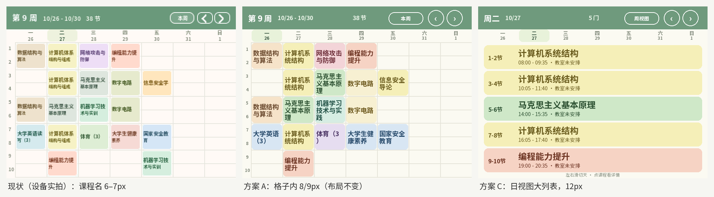

# 课程表字体放大方案（2026-10-28）

> 对象：第 5 页课程表（`src/saved_design/screen_schedule.cpp`，7 天 × 1–10 节，320×240 横屏）。
> 预览：`design/schedule-fonts/comparison-2x.png`（现状 / A / C）、`option-*-3x.png`、生成脚本 `render_options.py`。
> 结论：**能放大，但受"7 天 × 10 节"网格限制，不能只改字号**——当前每格只有 **42×18.8 px**，课程名是 6–7px 两/三行。给三种方案，推荐 **A（不改布局）** 或 **C（日视图，可读性最好）**。

---

## 1. 现状与瓶颈（代码事实）

| 项 | 值 | 依据 |
|---|---|---|
| 网格 | 7 列 × 10 行；左侧节次栏 12px, 列宽 **44px**（块宽 42） | `screen_schedule.cpp:33-35` |
| 行高 | (238−50)/10 ≈ **18.8px** | `GRID_TOP=50`, `GRID_BOT=238` |
| 课程名 | 第 1 行 **7px**、续行 **6px**；固定 5 字/行、行高 9px；块高决定行数 | `:250-268`, `:490-499` |
| 页头 | 周标题 11px、日期/节数 8px、"本周" 7px | `:390-418`, `:630` |
| 详情弹层 | 课程名 14px、副标题 8px、标签 7px、值 10px | `:309-353` |

**为什么不能直接调大字体**：单元格宽 42px，10px 汉字一行只能放 3 个（4 个需 40px + 边距会裁切）；行高 18.8px 放不下 2 行 10px。所以字号、每行字数、行数、块高必须一起算——要么少显示信息，要么改视图结构。

---

## 2. 三个方案

### 方案 A（推荐，先做）：格子内字号 6–7 → 8–9px，网格/坐标完全不动

- 块高自适应：单行块 1 行 **8px**（4 字+省略号）；多行块最多 3 行 **9px**（行高 10，4 字/行），可显示 12 字（覆盖绝大多数课程名）。
- 页头同步：周标题 11→12、日期/节数 8→9、"本周" 7→8；详情：副标题 8→10、标签 7→8、值 10→12。**只改字号/行数，不改任何坐标、列宽、行高、卡片位置。**
- 预期效果：课程名清晰度约 +30%（见对比图）；代价是单行块更早出现"…"（点击详情可看全名，详情本来就有 14px 大字）。
- 工时约 **2–3h**（含 host 20 帧里 `schedule-current` 基线更新、设备 page-5 golden 更新、实板截图核对）。
- 风险低：不新增控件、不改交互；只影响第 5 页静态像素（需你确认这是允许的视觉变化）。

### 方案 C（体验最好，工作量更大）：课程表改为"日视图"，周视图保留为切换

- 默认显示**当天课程列表**：课程名 **12–13px**、时间/教室 8px、每条 33px 高；顶部 7 个日期标签，左右滑/点标签切天；右上"周视图"按钮回到现有网格。
- 可读性最好，信息密度换清晰度；左右滑切天与现有"7 页循环"手势需要重新约定（进入该页后横滑先切天，到边界再翻页，或仅用点标签切天）。
- 工时约 **1–1.5 天**（页面逻辑 + 手势约束 + host/设备 golden + 设计确认）。
- 风险中：新交互 + 手势冲突规则，需要你确认切天方式。

### 方案 B（不推荐）：显示 8 节 + 纵向滚动，字号 10px

- 10px 在 42px 块宽里一行只能 3 字，省略号比 A 更多（预览里几乎每格都是"计算…"），可读性反而下降；还需滚动容器与防误触配合。
- 说明：滚动条会与"滑动防误触/边缘返回"再叠一层交互，不划算。

---

## 3. 推荐与实施计划（方案 A）

1. `splitCourseName()` 改为**按字号宽度**切行（9px→4 字/行，8px→5 字/行，标点不落行首）；
2. `drawCourseBlock()` 按块高自适应：单行块 8px/1 行；多行块 9px、行高 10、最多 3 行；文字区垂直居中；
3. 页头/详情字号 +1~2px（见上），坐标全部不动；
4. 验收：host `schedule-current` 帧更新（已批准变化）→ `verify.ps1 -UpdateGolden` 前人工核对；设备侧只允许 `page-5-schedule` 哈希变化，其它 30 视图必须 0 差异；实板截图与详情弹层各 1 张；
5. 回滚：单文件 `screen_schedule.cpp` + 两个 golden 基线，改动前快照仍在。

> 你确认后即可按 A 实施（约 2–3h，含实板复核）。若要 C，我先出日视图的正式设计稿再动代码。

---

## 4. 实板实施结果（2026-10-28 晚，已烧录）

**已按方案 A 落地**，唯一改动的固件文件：`hardware/arduino/yiyi_desk/src/saved_design/screen_schedule.cpp`（+ 新增 1 个跨文件字体引用；页面坐标/网格/行高/卡片位置全部未动）。

### 4.1 实际实现

| 项 | 实现 |
|---|---|
| 课程块字号 | 单行块（1 节）**8px / 1 行 / 4 字**；多行块（≥2 节）**9px / 最多 3 行 / 4 字/行 / 行高 10**；文字垂直居中 |
| 切行 | `splitCourseName(name, charsPerLine, maxLines, …)` 按字号宽度切行；**收尾标点（、。，；：！？）》】」』”’…·）不落行首**，避免出现"）"单独一行 |
| 页头 | 周标题 11→**12px**（用共享 `fd_sans_bold_12`，`saved_resources.h` 无 12px 别名）；日期/节数 8→**9px**；"本周" 7→**8px** |
| 详情浮层 | 副标题 8→**10px**、标签 7→**8px**、值 10→**12px**；标题保持 14px |
| 未改 | 网格线、列宽 44、行高 18.8、卡片坐标、页面坐标、字体文件（未新增字体，仅引用已链接的 12px 字体）、其它页面 |

### 4.2 固件与门禁

| 项 | 结果 |
|---|---|
| 固件 | **5,787,392 B / 58.09%**（+288 B）；bin SHA-256 `5CC0D8CD…`；设备 `sketchMd5=0b7656d2…` |
| host 20 帧 | 只有 **schedule-current** 变化（`b7d70bc7…` → `c0976218…`），其余 19 帧逐字节不变；`verify.ps1` PASS |
| 设备 golden | `page-5-schedule` `b7d70bc7…` → **`c0976218…`**（与 host 帧哈希**完全一致**）、`schedule-detail` `c49ba0f6…` → `b0312802…`；其余门禁视图不变；最终 **PASS=31 / SKIP=1** |
| 实板 | 页面与详情见 [device-A-page5-week9.png](device-A-page5-week9.png)、[device-A-detail.png](device-A-detail.png)；selftest PASS |

**数据驱动视图的处理**：验证期间发现设备在 5 小时空档里被联网使用过（天气/诗词/每日记录缓存已刷新），导致 weather/reading/daily 等 7 个视图与旧基线漂移。处理：

1. 用旧/新固件在**同一数据状态**下各抓一次（A/B）：这 7 个视图 PNG **逐字节相同**，证明字体改动只影响课程表两帧；
2. 把这 7 个视图标为 **informational（`hash=false`，只出图不参与门禁）**，因为其内容本就依赖实时/缓存数据；
3. 用 `--update-only` 更新该 7 个视图 + 课程表两帧的基线，之后全量复核 PASS。

### 4.3 设备 golden 确定性修正

- `page-5-schedule` / `schedule-detail` 入口改为：`page 0` → `timeset 1793066160` → `page 5` → **`tap 245 16`（本周）** →（detail 再 `tap 77 69`）。原因：课程表 `selectedWeek` 是模块静态变量，设备上一次浏览到第 8 周后，单靠 `timeset` 不会把选中周切回第 9 周；点"本周"才确定。
- **设备 golden 必须离线**：`wificred __offline__ x` 覆盖临时凭据 → 重启（清 weatherValid）→ 跑 golden。验证完成后可用 `wificred <真实 ssid> <password>` 恢复（本次已恢复为热点 `qingyu`，设备当前 `wifi=false` 是因为电脑移动热点已关闭，热点开启后会自动重连）。
- 联网使用设备会刷新 weather/reading/daily 缓存，使 informational 视图变化；gated 视图（页面布局类）不受影响。

### 4.4 回滚

改动前快照：`build/backups/schedule-font-A-20261028-1950/`（原 `screen_schedule.cpp`、旧 bin `B2599156…`、原 `render-hashes.json`/`device-hashes.json`）。回滚 = 恢复该文件与两个 golden JSON，重刷旧 bin。

**未做（可选）**：方案 C 日视图（12–13px 大列表，需要新交互/设计稿）；方案 B 不推荐。

