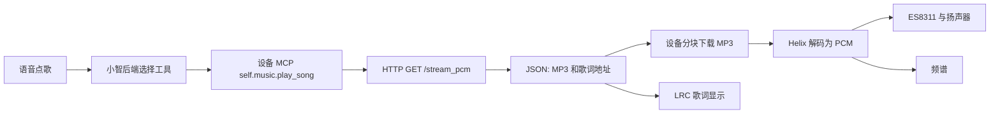
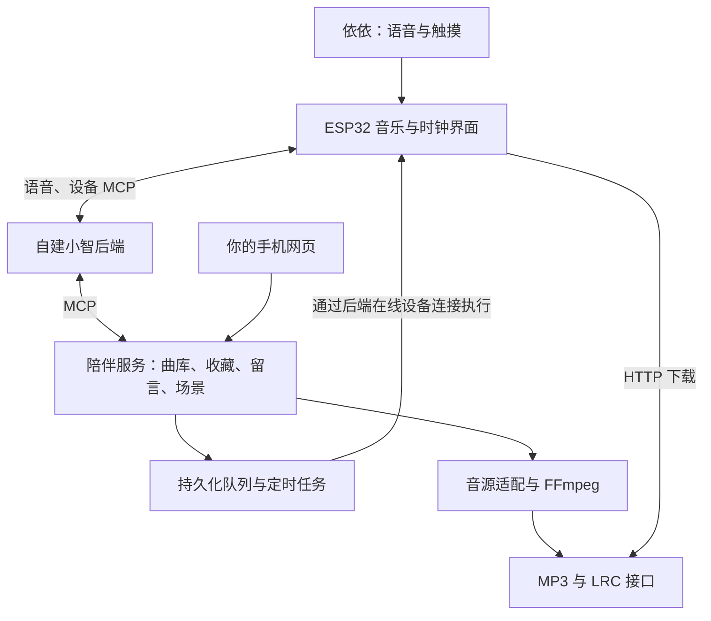

# 依依专属 MCP 音乐陪伴站

核查日期：2026-10-30。依据本地音乐固件源码、既有硬件验证记录，以及本次读取的 GitHub 文档和部分实现。本文是实施设计，未部署 VPS，未验证真实歌曲播放、音质或第三方在线音源可用性。

## 1. 推荐结论

推荐组合：**现有 ESP32 屏幕播放器 + VPS 自建小智后端 + 自定义陪伴 MCP 服务 + 自有曲库/可用音源适配器**。

先恢复现有 HTTP MP3 播放，保住歌词、频谱和板级适配；随后补齐播放器控制与音频仲裁，再加入远程点歌留言、心情歌单、学习/睡眠模式、纪念日惊喜。Navidrome 在需要管理较多歌曲、歌单和收藏时加入；Home Assistant 和 MCP Hub 留作扩展。

可以通过 MCP 点歌，也存在把音频作为 MCP 资源读取的方案。更准确的分工是：MCP 暴露能力，小智后端组织调用，音源服务提供内容，设备负责播放。**“接上一个音乐 MCP”并不等于这版设备固件会自动播放它返回的 URL 或资源。**

## 2. 这块板和当前固件的实际情况

| 项目 | 核查结果 | 对方案的影响 |
| --- | --- | --- |
| 硬件 | LCDWiki ES3C28P，ESP32-S3 N16R8，16 MB Flash / 8 MB PSRAM，320×240 触摸屏，ES8311 | 适合语音、流式音乐、歌词、简单动画和触摸交互；主要模型放服务器 |
| 代码基线 | Maggotxy 音乐 fork，源自小智 v1.8.5；本地版本标成 `2.5.0-music` 用于桌面识别 | 不能假定拥有当前上游 2.x 的全部功能 |
| 分区 | app0 桌面 7.5 MiB，app1 音乐小智 5 MiB，另有模型区；音乐应用约 4.06 MB | 新功能要关注应用空间；保留双应用的 OTA 写入限制 |
| 云端连接 | 2026-10-29 记录确认 Wi-Fi 连接和 MQTT 证书/连接成功 | 不等于真实语音音频通道、对话和音乐都已验收 |
| 原音乐地址 | `http://110.42.59.54:2233`，本次核查不可达 | 可替换为 VPS；仅凭不可达不能断言永久停服 |
| 应用切换 | `ExitToDesktop()` 选择 app0 后调用 `esp_restart()` | 返回原时钟桌面会停止音乐、小智和 app1 MCP |

既有移植说明较早的“网络未验证”和“原服务器已停服”等表述不作为本次更强结论；以新增现场记录及当前证据为准。

### 2.1 当前点歌链路



关键源码：

- `esp-idf/yiyi_music/main/mcp_server.cc:110`：`self.music.play_song(song_name, artist_name)`。
- `esp-idf/yiyi_music/main/boards/common/esp32_music.cc:333`：读取 NVS `music/server_url`，请求 `/stream_pcm?song=...&artist=...`。
- 同文件 `DownloadAudioStream`：HTTP 分块取音频；`PlayAudioStream` 使用 Helix 解码 MP3。
- `esp-idf/yiyi_music/main/application.cc:870` 附近：音乐 PCM 经 `AddAudioData` 直接输出到 codec。

`/stream_pcm` 这个名字容易误导：它返回的是 JSON，实际下载的是 MP3，并非直接返回 PCM：

```json
{
  "artist": "歌手",
  "title": "歌名",
  "audio_url": "http://your-vps/media/song.mp3",
  "lyric_url": "http://your-vps/lyrics/song.lrc"
}
```

播放器边下载边解码，缓冲上限 256 KiB，起播阈值 32 KiB，无需装下整首歌。立体声会混为单声道；LRC 用于逐句歌词，PCM 用于频谱。

当前输入/输出设置均为 16 kHz。`SetOutputSampleRate` 调整 I2S 时钟，但该路径没有同步重配 ES8311 寄存器。**第一阶段由 VPS 输出 16 kHz、单声道、32–64 kbps MP3**，先验证播放；更高采样率需另做 codec/重采样与麦克风并行验证。

### 2.2 已有能力和缺口

已有音乐 MCP 工具只有：

- `self.music.play_song`：按歌名和可选歌手开始播放。
- `self.music.set_display_mode`：歌词 / 频谱。

此外有通用音量、亮度、状态等工具。当前缺少音乐暂停、继续、停止、下一首、队列、进度等 MCP 接口；串口有 `musicstop`，不代表语音工具已经具备停止功能。

离开 idle 进入其他状态时会停止音乐，不会自动续播。因此“唤醒后调音量、再接着听”要补播放器状态保存、恢复和音频仲裁。当前 `Range: bytes=0-` 总从零开始，不能据此宣称已经支持断点续播或拖动进度。

32 KiB 起播缓冲在低码率下也会影响点歌等待时间，后续应按目标缓冲时长调优，并保留弱网稳定性验证。

## 3. MCP 播音乐的三条路径

| 路径 | 音频如何到达设备 | 现成部分 | 对本项目的适合程度 |
| --- | --- | --- | --- |
| 设备 MCP + HTTP MP3 | 工具控制设备，设备请求音频直链 | 当前 fork 已实现按歌名查询和 MP3/LRC 播放 | **主推荐**；最容易恢复现有歌词、频谱 |
| 后端音乐插件 + 语音通道 | 后端读取音频、编码，沿普通语音音频通道下发，通常为 Opus | xinnan 后端 `play_music.py` 能扫描本地音乐并交给音频队列 | 可绕过旧接口；现有 MP3 歌词/频谱不会自动复用 |
| MCP 音频资源 + 支持它的后端 | MCP 返回 `ResourceLink`，后端分页 `resources/read`，解码/转换后经音频通道播放 | hackers365 Go 后端明确支持；有独立 `mcp_audio_server` 示例 | 适合研究直接由 MCP 提供音频；需验证旧固件兼容并适配界面 |

因此，之前“音乐必须经过 `/stream_pcm`”的说法需要修正：**保留当前播放器时需要兼容它的查询入口；换成后端音频通道可以完全绕过它。**

MCP 标准可以承载音频内容和资源链接；“自动读资源、分页参数、结束标志、把资源播放到小智设备”还需要客户端实现。某音乐 MCP 的 README 写着支持小智官方平台，也不能替代对具体后端和固件的兼容验证。

设备在现有小智协议里提供 MCP Server 工具，小智后端作为客户端调用。VPS 上的天气、曲库、留言等也是 MCP Server，由后端调用；Python/Node 服务运行在 VPS，ESP32 不需要安装这些运行时。

## 4. 推荐架构



| 组件 | 建议 | 用途 |
| --- | --- | --- |
| 语音与工具后端 | `xinnan-tech/xiaozhi-esp32-server`，先用简化部署 | 接模型 API、设备 MCP、服务端 MCP；先验证当前旧 fork 的 WebSocket/音频配置 |
| 陪伴服务 | 一个小型 Python 服务：FastMCP + HTTP API + SQLite | 曲库查询、收藏、留言、场景；提供现有 `/stream_pcm` 兼容入口及手机控制页 |
| 音频处理 | FFmpeg，按需转码并缓存 | 把曲库和不同音源转换为设备能稳定播放的 MP3 |
| 曲库 | 初期可直接文件目录；曲目增多后加入 Navidrome | 管理专属曲库、歌单和收藏，通过 Subsonic API 适配 |
| 模型 | 先接远程 ASR/LLM/TTS API | 不要求 VPS 有 GPU；调用和用量成本仍需按服务计算 |
| MCP 管理台 | 工具多时再选 mcphub 或 endpoint relay | 管理、分组和桥接；首版后端能直连 MCP 时可省去 |
| 家居扩展 | 家中已有 Home Assistant 时接入 | 灯光、窗帘、音箱等场景联动 |

经验规划：API 模型、单设备、少量并发转码的初始部署，可从 2 核 / 4 GB 内存评估。该数值不是资源保证；完整管理后台、数据库、本地语音模型和大量实时转码会提高需求，部署前以 VPS 实际配置确认。

当前仍在用官方云的设备，可以先只替换音乐 HTTP 地址修好播放，再迁移语音后端；迁移时保留原连接配置便于回退。配置 `musicurl` 只改变音乐查询地址，不会把语音云同时迁到 VPS。

### 4.1 设备侧拟新增的能力

以下均为待实现接口，并非当前固件已有：

- `self.music.play_media`：通过媒体 ID 或受控 URL 播放，附带歌名、歌手、歌词地址；避免只能按歌名二次搜索。
- `self.music.control`：停止、暂停、继续。暂停/继续要保持真实播放位置，不能只改布尔值。
- `self.music.get_status`：当前媒体、状态、实际进度和失败原因。
- `self.display.show_card`：显示留言、计时器、纪念日等卡片。
- 队列操作由陪伴服务统一维护；曲终、失败、进度通过约定的设备事件/后端接口上报，不能只靠模型猜测。

语音、音乐、提示音共用一个输出仲裁：唤醒时暂停音乐，回复结束后按场景恢复；新点歌或明确停止时取消旧会话。下一首、睡眠关机和准点任务由程序执行，不让 LLM 持续等待或负责逐首触发。

陪伴服务到设备之间还需显式的执行桥接：后端接收媒体/场景命令，再通过当前设备连接调用设备工具。普通 MCP 工具返回一个 URL 或“已加入队列”文本，不会自动触发另一个设备工具。远程留言和定时任务也使用这条桥接；需要时补设备保持在线的控制连接及重连逻辑。

### 4.2 屏幕和桌面

短期在 app1 内增加“时钟 / 歌词 / 频谱 / 留言”视图，切视图不重启，即可实现边看时钟边听歌。原 app0 桌面继续通过现有返回入口使用。

若要求现有完整桌面、宠物、所有应用与音乐在同一时刻运行，需要进一步合并架构或向较新上游重新移植播放器，工作量明显大于接一个 MCP。MCP 本身不会让两个固件分区同时执行。

## 5. 最值得做的玩法

以下是本方案的目标玩法，除基础点歌/歌词/频谱外均需开发或接入。

| 玩法 | 交互示例 | 需要补什么 |
| --- | --- | --- |
| 心情 DJ | “今天有点累，放温柔的歌，不要太吵。” | 曲目情绪/风格标签、个人喜好、可播曲库；让模型选场景和队列 |
| 你的专属点歌留言 | 你在手机选一首歌、写一句话；设备显示“天给你点了一首歌”并播放留言和歌曲 | 手机页、在线设备控制、留言存储、语音/音乐切换；可设置安静时段 |
| 学习搭子 | “陪我学习 25 分钟。” → 倒计时、轻音乐，结束时提醒 | 程序计时器、屏幕卡片、结束事件；不用模型计时 |
| 睡前电台 | “讲一点今天的趣事，再放雨声，20 分钟后停。” | 内容/TTS、环境音、持久化任务、渐弱或定时停止 |
| 纪念日惊喜 | 到设定日期显示一张专属卡片，播你的留言和指定歌曲 | 时间表、素材、设备在线检查、失败补投、去重 |
| 听歌猜歌 | 播 5 秒前奏，依依猜歌，屏幕记录分数 | 片段播放、答案库、游戏状态；避免只让模型臆测音乐内容 |
| 每日陪伴 | 天气、当天日程、一句留言、今日歌曲 | 天气/日历工具与授权、定时任务、简洁卡片 |
| 家居氛围 | “开启晚安模式。” → 灯光变暗、设备播音乐 | Home Assistant 与家居设备；大音箱播放另接播放器适配 |

首批优先做：**远程点歌留言 + 学习搭子 + 睡前电台**。这三项最能体现礼物的专属感，也能复用队列、留言、定时器和屏幕卡片。

两台设备间的语音留言/通话也可以作为后续目标。xinnan 后端有设备呼叫插件，但还依赖第二台设备、管理接口/通讯录和兼容验证。

## 6. GitHub 项目核查与取舍

| 项目 | 本次核查内容 | 选择建议 |
| --- | --- | --- |
| [78/xiaozhi-esp32](https://github.com/78/xiaozhi-esp32) | 当前上游 MCP 使用/协议文档、源码快照 | 用来理解设备工具协议和后续升级方向；当前旧 fork 不自动获得其新功能 |
| [xinnan-tech/xiaozhi-esp32-server](https://github.com/xinnan-tech/xiaozhi-esp32-server) | MCP 配置与部署文档；`play_music.py` 及 TTS 文件音频处理代码 | **推荐主后端**；已有音乐插件是本地文件播放基础，不等于完整音乐产品 |
| [78/mcp-calculator](https://github.com/78/mcp-calculator) | `mcp_pipe.py` 与接入说明 | 学习小智 MCP 接入点/stdio 桥接的简洁起点 |
| [hackers365/xiaozhi-esp32-server-golang](https://github.com/hackers365/xiaozhi-esp32-server-golang) | MCP 音频资源处理、分页和远程设备工具调用文档 | **研究 MCP 音频路径的备选后端**；没有在本设备实测 |
| [hackers365/mcp_audio_server](https://github.com/hackers365/mcp_audio_server) | 独立项目 README，ResourceLink + 分页 Blob 协议 | 可借鉴音频 MCP 模板；其搜索依赖外部站点，长期使用要替换为可控音源 |
| [ABUGG-007/xiaozhi-mcp-music](https://github.com/ABUGG-007/xiaozhi-mcp-music) | README、`app.py`、`resource_proxy.py`；确实返回资源并实现 HTTP Range 读取 | 可参考资源协议和音源适配；音源“稳定”的 README 声明未做在线验证；不能据此保证官方云或本机可用 |
| [navidrome/navidrome](https://github.com/navidrome/navidrome) | README 的曲库、播放列表及 Subsonic 能力 | 曲库管理推荐；需要自己补 MCP/设备音频适配 |
| [PrefectHQ/fastmcp](https://github.com/PrefectHQ/fastmcp) | MCP 服务框架 README | 用于写专属陪伴工具；自身不提供曲库和播放器 |
| [huangjunsen0406/xiaozhi-mcphub](https://github.com/huangjunsen0406/xiaozhi-mcphub) | 多接入点、工具分组、控制台、PostgreSQL/pgvector 说明 | 工具多后再用，单设备首版不必增加这组依赖 |
| [xinnan-tech/mcp-endpoint-server](https://github.com/xinnan-tech/mcp-endpoint-server) | WebSocket 注册/转发与多服务聚合文档 | 需要接入点桥接时选用；不是播放器 |
| [home-assistant/core](https://github.com/home-assistant/core) 与 [music-assistant/server](https://github.com/music-assistant/server) | 官方 MCP 文档及 Music Assistant 能力说明 | 后续家居/大音箱玩法；不会自动把任意 ESP32 变成支持的播放器 |

排除为直接落地选项：

- `bangjiong925-commits/xiaozhi-music-mcp`：README 承认模拟数据，代码搜索返回 `music.example.com`，播放函数只修改 Python 字典，没有设备音频输出。
- `Qls12E/XiaoZhi-Music-Player`：README 直接注明“模拟音乐播放”，不能因工具列表完整就认作可播放方案。

Home Assistant/音箱自动发现应在家庭网络内处理；仅在远端 VPS 部署 Music Assistant，不会自动发现家里的局域网音箱。在线歌曲是否能播放取决于账户、音源接口、地区和具体曲目，MCP 不会凭空提供全曲库。专属曲库和可替换的音源适配器应作为长期基础。

## 7. 实施顺序和验收

### 第一阶段：恢复当前音乐

1. VPS 建兼容 `/stream_pcm` 的小服务，先用几首确定可读的测试音频及 UTF-8 LRC。
2. 输出 16 kHz 单声道 MP3，验证字节读取、HTTP 状态和设备可达性。
3. 串口设置 `musicurl http://<vps>:<port>`，用 `music <歌名>` 排除语音选错工具的干扰。
4. 验收真实出声、音调、连续播放、歌词/频谱、弱网失败和退出；随后验证语音确实调用 `self.music.play_song`。

这一阶段配置音乐地址无需重新编译；现有工具已经支持读取 NVS 覆盖。

### 第二阶段：让它成为可控播放器

补媒体 ID/直链播放、停止/暂停/继续、真实状态、队列与曲终事件；建立语音/音乐仲裁；修正 320×240 频谱适配；在 app1 增加不重启的时钟视图。

验收重点：下一首实际切歌，停止后不被旧任务重新播放；唤醒中断后恢复符合指令；切换 app1 内视图不断音；返回 app0 的停止行为清楚可见。暂停续播和进度操作只有完成相应音频定位/恢复机制后才对外开放。

### 第三阶段：上线专属玩法

部署自建小智后端与陪伴 MCP，迁移并验证设备连接；上线手机点歌留言页、收藏、学习/睡眠场景和纪念日任务。设备不在线时应保存任务并按策略补投，任务执行要有去重与结果记录。

自建后端可以和第一阶段并行准备；是否迁移成功以本设备的工具发现、实际对话、音频播放测试为准。现有语音连接配置保留回退路径。

### 第四阶段：扩展

按需求加入 Navidrome、Home Assistant、大音箱、第二台设备，或单独试验 Go 后端的 MCP 音频资源链路。若要全面升级当前固件基线，作为独立移植任务处理。

## 8. 部署所需信息

当前尚无 VPS 连接信息，未连接或修改 VPS。实际部署需要服务器地址、SSH 用户/端口和可用密钥方式，以及系统、CPU/内存、域名和已有服务情况；不需要为了本方案先重装 VPS。

源码/文档快照位于工作区 `build/research/`。本次只新增本方案文档，没有改固件逻辑、刷机或启动外部服务。
